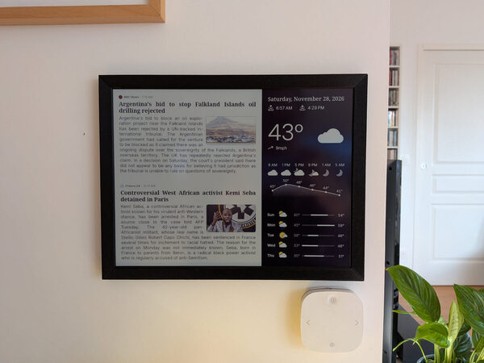
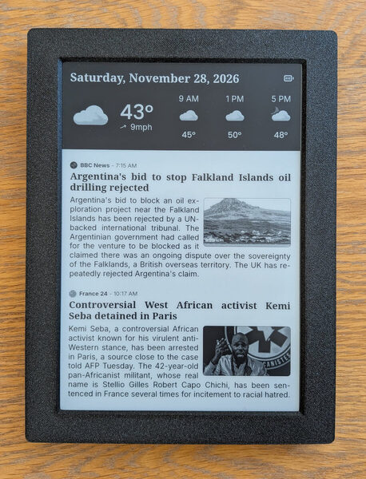

# epaper-dashboard

An e-paper dashboard that displays news from RSS feeds and weather forecasts from the [MET Norway Weather API](https://api.met.no/)

[](./docs/preview-spectra6.jpeg)
[](./docs/preview-inkplate10.jpeg)

The [enclosure for the Spectra6](./spectra6_enclosure.f3d) is published on [Printables.com](https://www.printables.com/model/1932725-enclosure-for-spectra-6-and-seeed-studio-ee02).

## Supported hardware

- [Inkplate 10 V2](https://soldered.com/collections/fast-refresh-e-paper-modules/products/inkplate-10)
- Spectra 6 ([Seeed Studio EE02](https://www.seeedstudio.com/XIAO-ePaper-Display-Board-ESP32-S3-EE02-p-6639.html))

## Server

The server generates the dashboard as an HTML page, uses Firefox to take a screenshot, and converts it into a PNG image that can be sent to the display.

### Docker quickstart

A prebuilt image is available on [Docker Hub](https://hub.docker.com/r/ugomeda/epaper-dashboard).

Create a configuration file from the example, then run the container:

```bash
cp config.example.toml config.toml

docker run --rm \
    --pull always \
    -v "$(pwd)/config.toml:/app/config.toml:ro" \
    -p 8000:8000 \
    ugomeda/epaper-dashboard:latest
```

### Run locally

Install and run the server using [uv](https://docs.astral.sh/uv/):

```bash
cp config.example.toml config.toml
uv sync
uv run playwright install firefox --with-deps
uv run uvicorn epaper_dashboard.app:app
```

### Access the dashboard

Once the server is running, the following endpoints are available:

**Live HTML:**
- [http://localhost:8000/live/display_1/html](http://localhost:8000/live/display_1/html)
- [http://localhost:8000/live/display_2/html](http://localhost:8000/live/display_2/html)

**Generated PNG:**
- [http://localhost:8000/live/display_1/png](http://localhost:8000/live/display_1/png)
- [http://localhost:8000/live/display_2/png](http://localhost:8000/live/display_2/png)

The display IDs correspond to those defined in `config.toml`.

### Configuration file

The server supports several displays, where each display has its own configuration containing its hardware profile, location, weather forecast, and RSS feeds.

See [config.example.toml](./config.example.toml) for an example.

#### Display settings

Each display is defined under `[displays.<id>]`.

| Setting | Description |
|---|---|
| `profile` | Hardware profile: `inkplate10` or `spectra6` |
| `location` | Geographic coordinates as `[latitude, longitude]` |
| `timezone` | IANA timezone, e.g. `Europe/Paris` |
| `locale` | Locale used, e.g. `fr_FR` |
| `units` | Measurement units: `metric` or `imperial` |
| `refresh_interval_sec` | Time between dashboard refreshes, in seconds |
| `weather_forecast_step_hours` | Interval, in hours, between weather icons in the forecast (default: `4`) |
| `news_user_agent` | HTTP User-Agent used for fetching news, mostly used to circumvent bot protections on some RSS feeds |
| `news_summary_words` | Target number of words in article summaries (±15%) |

#### Feeds settings

Each display can have multiple `[[displays.<id>.feeds]]` entries.

| Feed setting | Description |
|---|---|
| `url` | RSS feed URL (HTTP or HTTPS) |
| `ignored_elements` | List of CSS selectors identifying elements to exclude from the article content |

#### Cache settings

Optionally, you can add a `[cache]` section to override defaults. All TTL values are expressed in seconds.

| Setting | Default | Description |
|---|---:|---|
| `path` | `.cache` | Cache directory |
| `weather_ttl` | `6600` | Weather forecast cache lifetime |
| `sun_ttl` | `172800` | Sunrise and sunset data cache lifetime |
| `rss_feed_ttl` | `1800` | RSS feed cache lifetime |
| `rss_article_ttl` | `7200` | Article content cache lifetime |
| `rss_image_ttl` | `7200` | Article image cache lifetime |

## Firmware

The firmware is built with [ESP-IDF](https://docs.espressif.com/projects/esp-idf/en/stable/esp32/get-started/index.html) 6.1.

```bash
cd firmware

# for inkplate 10
idf.py --preset inkplate10 menuconfig

# for spectra6
idf.py --preset spectra6 menuconfig
```

Under **Dashboard configuration**, configure:

- Wi-Fi SSID
- Wi-Fi password
- PNG URL: `http://<IP>:8000/live/<display-id>/png`
- Low-battery threshold

Then flash your device:

```bash
# for inkplate10
idf.py --preset inkplate10 build flash monitor

# for spectra6
idf.py --preset spectra6 build flash monitor
```

## Assets

- Weather icons: https://github.com/nrkno/yr-weather-symbols
- Icons: https://github.com/lucide-icons/lucide
- Fonts: https://github.com/fontsource