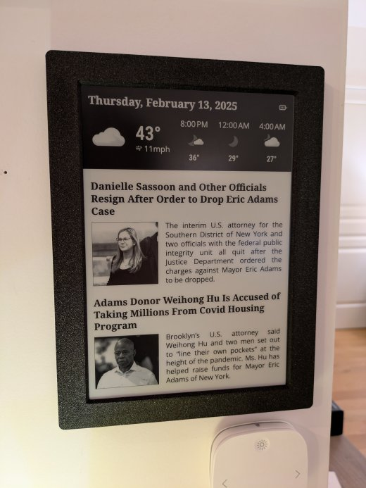

inkplate-dashboard
==================

Project to display a simple dashboard on an Inkplate 10 displaying articles
from an RSS feed and the current weather, provided by the
[MET Weather API](https://api.met.no/).



## Server

The server generates the dashboard as an HTML page, and uses Firefox to
screenshot it and generate a PNG which can be sent to the Inkplate 10.

### Docker quickstart

An image is provided on [dockerhub](https://hub.docker.com/r/ugomeda/inkplate-dashboard):

```
docker run \
    --pull always \
    -v $(pwd)/config.example.toml:/app/config.toml:ro \
    -p 8000:8000 \
    ugomeda/inkplate-dashboard:latest
```

Then access:

- Live HTML version: http://localhost:8000/live/html
- Live PNG version: http://localhost:8000/live/png

### Run locally

To run the server:

- Create a stub configuration by copying `config.example.toml` to `config.toml`
- Install Firefox
- Run the application

```
cp config.exemple.toml config.toml
uv run playwright install firefox --with-deps
uv run uvicorn inkplate_dashboard.app:app
```

You should be able to access the dashboard on the following URLs:

- Live HTML version: http://localhost:8000/live/html
- Live PNG version: http://localhost:8000/live/png

## Firmware

The firmware is built with [ESP-IDF](https://docs.espressif.com/projects/esp-idf/en/stable/esp32/get-started/index.html) 6.1 and supports:

- Inkplate 10 V2
- Spectra 6 (on Seeed Studio EE02)

```bash
cd firmware

# for inkplate 10
idf.py --preset inkplate10 menuconfig

# for spectra6
idf.py --preset spectra6 menuconfig
```

Under **Dashboard configuration**, configure:

- Wi-Fi SSID
- Wi-Fi password
- PNG URL
- Low-battery threshold

Then flash your device:

```bash
# for inkplate10
idf.py --preset inkplate10 build flash monitor

# for spectra6
idf.py --preset spectra6 build flash monitor
```

## Assets

This projets uses:

- Weather icons: https://github.com/nrkno/yr-weather-symbols
- Icons: https://github.com/lucide-icons/lucide
- Fonts: https://github.com/fontsource